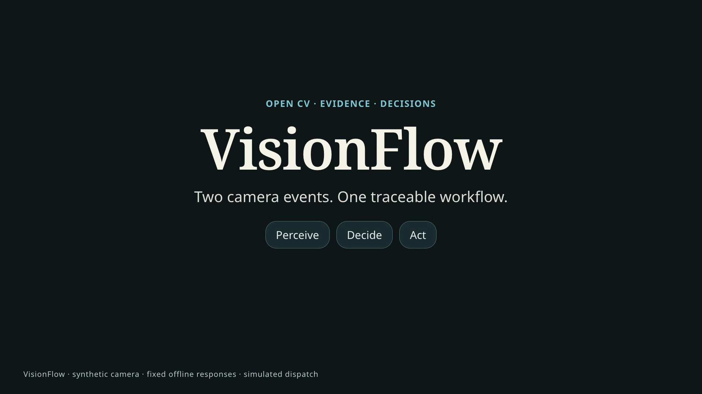
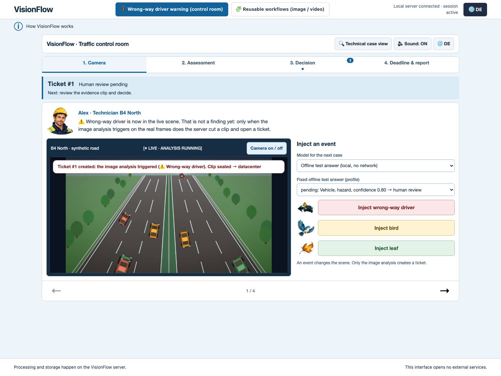
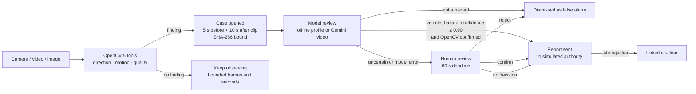

# VisionFlow

**Reusable OpenCV 5 vision workflows in which the pixels decide what happens next.**
A camera, a video or a single image goes in; OpenCV measures; the measurement opens a case,
asks for more evidence, involves a model and a human under a deadline, and ends in a bounded,
logged action. The flagship example is a **wrong-way driver warning** you can try in the browser.

[](https://youtu.be/hyKPwB1lc6M)

| Try it | Where |
|---|---|
| **Live demo** (no install, synthetic traffic) | [Open the AWS control room](https://d2fmnfnvxb0cs1.cloudfront.net/) |
| Demo video (2:59, English) | [Watch on YouTube](https://youtu.be/hyKPwB1lc6M) |
| Local install | [Quick start](#quick-start) below |
| Technical report | [docs/TECHNICAL_REPORT.md](docs/TECHNICAL_REPORT.md) |

Built for the [OpenCV AI Competition 2026, powered by AWS](https://opencv26.devpost.com/) by
Lukas Geiger (solo). Track: Agentic Vision with OpenCV 5.



## Why

Traffic operators cannot watch every camera, and a pure "AI alarm" floods them with false alarms:
a bird flying against the traffic or a leaf blowing across the lane moves exactly like a
wrong-way driver. VisionFlow keeps the cheap, fast pixel analysis on every frame, but turns each
hit into an **evidence-bound case**: the same immutable clip goes to a model and to a human,
there is a real deadline, and every step is in the trace.

The same controller is not a one-off traffic app. Workflows are JSON files: swap the tool, the
input and the follow-up rules, and the identical core checks document quality, watches a video
for motion, or monitors a road.

## How the loop works



1. **Perceive.** The `direction` tool tracks native-resolution grayscale patches between frames
   (NCC ≥ 0.80, unique peak, forward/backward check within 1.5 px) and reports tracks that move
   against the configured lane vector. It never sees scenario labels, only pixels.
2. **Decide.** A hit stops the observation and opens a case. The recorder cuts an immutable H.264
   clip (5 s before, 10 s after) and hashes it. The model stage receives exactly that clip; the
   human sees the same hash.
3. **Act.** The decision policy either dismisses the case, escalates it at high confidence, or
   waits for a human until the server-side deadline. Notifications go to a simulated inbox; a
   rejection after an automatic report creates a linked correction. Nothing real is ever sent.

Every run is bounded by frame, observation-time and model-call budgets, and a model answer can
never authorize a new media source or a new output destination.

## The control room demo

The browser interface turns the road workflow into four rooms:

1. **Traffic room.** A live synthetic camera with traffic in both directions. Inject a wrong-way
   driver, a bird or a leaf. Injecting is not a detection: only the analysis decides.
2. **Data center.** The OpenCV stage, the clip, the actual model request and answer, with their
   source clearly labelled (offline profile or Gemini).
3. **Dispatch Alpha.** Human review of the hash-verified evidence clip: confirm or reject.
4. **Dispatch Beta.** The real deadline. If nobody decides, the server reports automatically.

Each detection creates a numbered ticket that appears at its current station: model review
in room 2, human review in room 3, and expired deadlines in room 4. A second event during a
review starts the next case on the same camera; stopping the camera keeps sealed tickets decidable.

The camera view draws boxes, motion arrows and an *OPPOSING MOTION* label only from the direction
tool's tracks of the very frame it shows; the header line reports the measured analyses per second
and the delay behind live, and a *Boxes* switch turns the overlay off (on by default). One scenario
event is analysed at a time: the inject buttons count down until the previous event has been
analysed, and the server rejects an earlier event with `409 event_cooldown` and `Retry-After`. When a
camera ends at its recording or time limit, room 1 says so and explains how to continue.

The public demo runs in **offline-profile mode**: the model step returns a fixed, selectable
answer and does not look at the image. Its second header button opens the reusable workflows,
which there run only the two bundled templates (document quality, motion observation) on
server-generated sample inputs; uploads, file paths and cameras are rejected. Everything else is real: rendered frames, OpenCV
analysis, clip export with SHA-256, deadlines and the simulated authority inbox. Live Gemini
video review is available locally with an explicit cost opt-in (see below).

## Reusable workflows

A workflow is a small DAG of `analyze`, `observe`, `branch`, `ask_model`, `request_input`,
`approve`, `output` and `report` nodes. The examples in
[`examples/workflows/`](examples/workflows/) all run on the same controller:

| Workflow | Input | What the pixels change |
|---|---|---|
| `document-quality.json` | image | Measures sharpness, requests a replacement photo (a fixed step of this template) and measures the replacement again |
| `motion-observation.json` | video | Measured motion goes to the model, which may request a bounded follow-up observation from the same video cursor, then a report |
| `road-monitor.json` | camera | Opposing motion stops the observation and selects the candidate branch |
| `road-review.json` | camera | Opposing motion opens an evidence case with model review, human decision and simulated escalation |
| `direction-review.json` | video file | The same direction analysis on a recorded video |

```json
{"id": "monitor", "type": "observe",
 "params": {"duration_seconds": 60, "sample_fps": 5,
            "stop_when": {"tool": "direction", "metric": "opposition_count",
                          "operator": "gte", "value": 1}},
 "next": ["candidate"]}
```

The same core is available through the Python API, the CLI and the local web interface.

## Quick start

Python 3.12+, and FFmpeg with `libx264` for the road clips.

```bash
python -m venv .venv
.venv/bin/python -m pip install -r requirements.lock      # Windows: .venv\Scripts\python.exe
.venv/bin/python -m pip install --no-deps -e .
.venv/bin/python -m visionflow.cli serve --port 8765      # then open http://127.0.0.1:8765/
```

Offline end-to-end demo without a server (document and motion workflows, real OpenCV frames):

```bash
.venv/bin/python -m visionflow.cli demo run --output-dir ./demo-out-01
```

Road case from the command line (start the server first):

```bash
.venv/bin/python -m visionflow.cli road create --seed 17
.venv/bin/python -m visionflow.cli road case start SOURCE_ID --mode fixture
.venv/bin/python -m visionflow.cli road inject SOURCE_ID wrong_way
.venv/bin/python -m visionflow.cli road case status CASE_ID
```

Live Gemini video review (costs may apply): set `GEMINI_API_KEY` and start
`serve --allow-gemini-costs`; road cases with `--mode gemini_video` then send the hash-bound
clip and evidence frames to the model, at most two requests per case.

## AWS

* **Public demo:** the unchanged loopback-only server runs with `--public-demo` on an
  **AWS Graviton (arm64) EC2** instance behind nginx, with **Amazon CloudFront** for HTTPS. The
  security group only admits CloudFront, there is no SSH (SSM only), uploads are disabled, the
  reusable workflows run only the bundled templates on server-generated samples, at most
  four live road sessions run at once and the service restarts fresh every day.
  Stack and deploy script: [`cloud/demo/`](cloud/demo/).
* **Reproducible cloud acceptance:** [`cloud/template.json`](cloud/template.json) and
  [`cloud/buildspec.yml`](cloud/buildspec.yml) run the full test suite and both OpenCV demos in
  **AWS CodeBuild** from an exact source ZIP in private S3 and return hashed evidence
  ([procedure](docs/AWS_ACCEPTANCE.md)).

On 14 October 2026, source `aeb2148` completed AWS CodeBuild: **615 passed, 1 skipped,
0 failed**, with both offline OpenCV demos passing. Exact source bytes, downloaded evidence
and actual AWS build metadata were verified; the temporary acceptance stack was deleted.
The public AWS demo also passed real bird dismissal and wrong-way deadline/report/late-correction
cases with downloaded clip hashes checked. Model answers remained fixed offline fixtures.
[Publication-safe results and limits](docs/AWS_RESULTS_2026-10-14.json).

Architecture overview: [docs/ARCHITECTURE.md](docs/ARCHITECTURE.md).

## Evaluation and limits

Synthetic, pre-declared protocol ([details](docs/SYNTHETIC_EVALUATION.md)); the RoadWorld part
can be rerun with [`evaluation/roadworld_eval.py`](evaluation/roadworld_eval.py):

* Known blur: sharpness ordering correct in 18/18 pairs.
* Known horizontal direction (36 sequences): TP 9, FP 0, TN 24, FN 3.
* RoadWorld scenes (16 sequences): direction candidates for normal traffic 0/4, wrong-way 4/4,
  bird 4/4, leaf 4/4. The pixel stage finds **opposing motion**, not vehicles. Read as a
  wrong-way-vehicle detector it gives TP 4, FP 8, TN 4, FN 0. Telling the bird and the leaf apart
  from a car is exactly the job of the model and human stages behind it.

Live model test (13 October 2026): five real Gemini video requests. The provider answered HTTP 503 ("high demand") or exceeded the 30-second client bound, and in every case the policy fell back to human review and the deadline, as designed. No model accuracy is claimed.

Limits: all traffic is synthetic, the parameters were tuned on known sequences (no blinded
holdout), and nothing here is a claim about real-road safety. Notifications are simulated.

## Tests

```bash
.venv/bin/python -m pytest -q
```

For packaged revision `aeb2148`, the GitHub Actions run on 14 October 2026 reports
**616 passed, 0 failed** on both Ubuntu and Windows. Both jobs also run the offline CLI demo
and build an actual wheel whose consumer starts a real road case outside the checkout.
[Source-bound CI result](https://github.com/ellmos-ai/VisionFlow/actions/runs/38491740474).

Browser acceptance scripts (Playwright with Edge or Chromium) live in `tests/` and are described
in [docs/TESTING.md](docs/TESTING.md).

## Security and responsible use

The server binds to loopback only. In local mode, workflows may read files the server account
can read, so do not expose it to untrusted users; the hosted demo uses `--public-demo`, which only
reads the synthetic road simulation and runs the two bundled document and motion templates on
server-generated samples; media uploads, file paths and cameras are rejected. Camera access needs an explicit
`--camera NAME=INDEX` mapping. Provider calls need an explicit cost opt-in and never carry
credentials in source. VisionFlow is a decision-support prototype: a human or a documented policy
stays responsible for every escalation.

## License and provenance

VisionFlow's original source is licensed under [MIT](LICENSE). Dependency licenses and
generated artwork provenance are documented separately in [THIRD_PARTY_NOTICES.md](THIRD_PARTY_NOTICES.md).

## Documentation

[Technical report](docs/TECHNICAL_REPORT.md) ·
[Architecture](docs/ARCHITECTURE.md) ·
[Jury instructions](docs/JURY_INSTRUCTIONS.md) ·
[Evaluation](docs/SYNTHETIC_EVALUATION.md) ·
[Testing](docs/TESTING.md) ·
[AWS acceptance](docs/AWS_ACCEPTANCE.md) ·
[Deutsche Kurzfassung](README_de.md)
