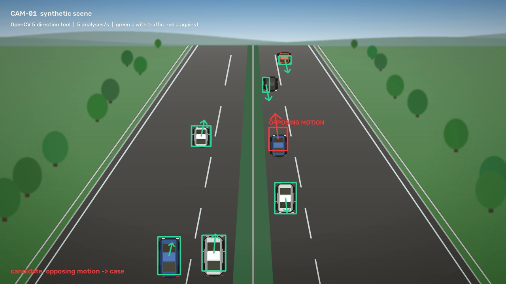

# VisionFlow (Deutsch)

**Wiederverwendbare OpenCV-5-Abläufe, in denen die Pixel entscheiden, was als Nächstes passiert.**
Kamera, Video oder Einzelbild gehen hinein; OpenCV misst; die Messung öffnet einen Fall, fordert
weitere Belege an, bindet ein Modell und einen Menschen unter einer Frist ein und endet in einer
begrenzten, protokollierten Aktion. Das Vorzeigebeispiel ist eine **Falschfahrer-Warnung**, die
im Browser ausprobiert werden kann.

Die vollständige Beschreibung steht im [englischen README](README.md); dort finden sich auch
Live-Demo, Video und alle Belege. Gebaut von Lukas Geiger (Einzelteilnahme) für die
[OpenCV AI Competition 2026, powered by AWS](https://opencv26.devpost.com/).

[Öffentliche AWS-Demo](https://d2fmnfnvxb0cs1.cloudfront.net/?lang=de) ·
[Devpost-Projekt](https://devpost.com/software/visionflow-yibs83).

[Vorführvideo ansehen](https://youtu.be/hyKPwB1lc6M) – 2:59 Minuten, englisch,
mit zwei echten aufgezeichneten Abläufen und elektronischer Originalmusik.



## Der Ablauf

1. **Wahrnehmen.** Das Werkzeug `direction` verfolgt Graustufen-Bildausschnitte von Frame zu
   Frame und meldet Spuren, die sich gegen die konfigurierte Fahrtrichtung bewegen. Es sieht nur
   Pixel, nie Szenario-Bezeichnungen.
2. **Entscheiden.** Ein Treffer beendet die Beobachtung und öffnet einen Fall. Der Server schneidet
   einen unveränderlichen Clip (5 s davor, 10 s danach) und versiegelt ihn mit SHA-256. Modell und
   Mensch prüfen genau diesen Clip.
3. **Handeln.** Die Entscheidungsregel verwirft den Fall, meldet ihn bei hoher Sicherheit sofort
   oder wartet bis zur Frist auf einen Menschen. Ohne Entscheidung folgt die automatische Meldung
   an ein simuliertes Behördenpostfach, eine spätere Ablehnung sendet eine verknüpfte Entwarnung.
   Es wird nie etwas Echtes versendet.

Die Oberfläche ist standardmäßig englisch; Deutsch über den Knopf „DE“ oder `?lang=de`.

Die öffentliche Demo zeigt synthetischen Straßenverkehr mit festen Offline-Antworten. Über den
zweiten Knopf in der Kopfzeile laufen dort auch die wiederverwendbaren Abläufe, allerdings nur die
zwei mitgelieferten Vorlagen (Dokumentqualität, Bewegungsbeobachtung) mit vom Server erzeugten
Beispiel-Eingaben; Uploads, Dateipfade und Kameras werden abgelehnt. Eigene Bilder und Videos
lassen sich in der lokalen App prüfen.

Das Kamerabild zeichnet Rahmen, Bewegungspfeile und das Label „GEGENBEWEGUNG“ nur aus den Spuren
des Richtungswerkzeugs für genau das gezeigte Bild; die Kopfzeile nennt die gemessenen Analysen pro
Sekunde und den Abstand zum Livebild, der Schalter „Rahmen“ blendet die Überlagerung aus
(Standard: an). Es wird jeweils ein Szenarioereignis analysiert: Die Einblende-Knöpfe zählen herunter,
bis das vorherige Ereignis ausgewertet ist, und der Server lehnt ein früheres Ereignis mit
`409 event_cooldown` und `Retry-After` ab. Endet eine Kamera an ihrem Aufnahme- oder Zeitlimit,
erklärt Raum 1, wie es weitergeht.

Jede Erkennung erzeugt ein nummeriertes Ticket an seiner aktuellen Station: Modellprüfung
in Raum 2, menschliche Prüfung in Raum 3 und abgelaufene Fristen in Raum 4. Ein zweites Ereignis
während einer Prüfung startet den nächsten Fall auf derselben Kamera; beim Kamera-Stopp
bleiben versiegelte Tickets entscheidbar.

Die überarbeitete Leitstelle führt dasselbe Ticket durch Kamera, Bewertung, Entscheidung
und Frist/Meldung. Die Einführung und technische Belege sind einklappbar; die schwarzen
Pfeile wechseln die Station. Die menschliche Entscheidung hat eine echte Frist von 60 Sekunden.

Für Paketrevision `aeb2148` bestehen die GitHub-Tests unter Linux und Windows jeweils mit
616 erfolgreichen Prüfungen und ohne Fehler. Auch ein tatsächlich installiertes Wheel
startet außerhalb des Quellordners einen Kamerafall. Die feste Offline-Antwort erkennt keine
Bildinhalte; sie bleibt in der Oberfläche ausdrücklich gekennzeichnet.

Die AWS-Abnahme besteht mit 615 erfolgreichen Tests, einem Skip und beiden Offline-Demos.
In der öffentlichen AWS-Demo sind der Vogel-Fall sowie die echte 60-Sekunden-Frist mit
automatischer Meldung und späterer Entwarnung anhand identischer Belegclips geprüft.
[Ergebnisse und Grenzen](docs/AWS_RESULTS_2026-10-14.json).

## Schnellstart

```bash
python -m venv .venv
.venv/bin/python -m pip install -r requirements.lock      # Windows: .venv\Scripts\python.exe
.venv/bin/python -m pip install --no-deps -e .
.venv/bin/python -m visionflow.cli serve --port 8765      # danach http://127.0.0.1:8765/
```

## Wiederverwendbar

Abläufe sind JSON-Dateien (`examples/workflows/`). Derselbe Kern prüft die Schärfe eines
Dokumentfotos und fordert eine bessere Aufnahme an, beobachtet Bewegung in einem Video oder
überwacht eine Straße – mit Grenzen für Frames, Beobachtungszeit und Modellaufrufe in jedem Lauf.

## Auswertung und Grenzen

Synthetische RoadWorld-Auswertung (16 Sequenzen): Richtungskandidaten bei Normalverkehr 0/4,
Falschfahrer 4/4, Vogel 4/4, Blatt 4/4. Die Pixelstufe findet Gegenbewegung, keine Fahrzeuge;
Auto, Vogel und Blatt zu unterscheiden ist Aufgabe von Modell und Mensch. Der Verkehr ist
synthetisch, die Empfänger sind simuliert, und es gibt keine Aussage über reale Straßen.
Reproduzierbar mit `evaluation/roadworld_eval.py`.

Technischer Bericht: [docs/TECHNICAL_REPORT.md](docs/TECHNICAL_REPORT.md) (englisch).

## Lizenz und Herkunft

Der eigene VisionFlow-Quellcode steht unter der [MIT-Lizenz](LICENSE).
Abhängigkeiten behalten ihre jeweiligen Lizenzen. Hinweise zu Komponenten und zur Herkunft
der generierten Illustrationen stehen in [THIRD_PARTY_NOTICES.md](THIRD_PARTY_NOTICES.md).
