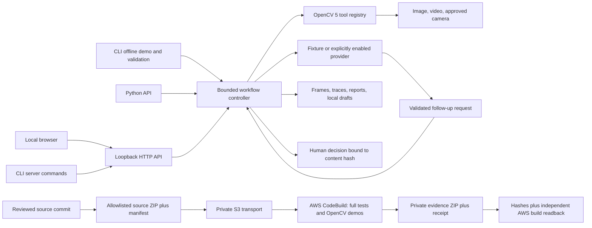

# VisionFlow architecture

The optional AWS branch is prepared infrastructure, not proof of an executed cloud run. It executes the existing controller and OpenCV tools without changing their contracts. CodeBuild supplies compute, Python and the pinned dependencies; S3 transports the exact committed input and generated evidence. No public HTTP endpoint is created. Provider calls require a separate explicit opt-in; the AWS acceptance recipe uses fixtures exclusively.

The road demonstrator uses synthetic traffic, pixel motion direction analysis, bounded recording, immutable clip hashes and human decisions. Notifications go to a simulated inbox. No real traffic-warning authority or external delivery is represented.
