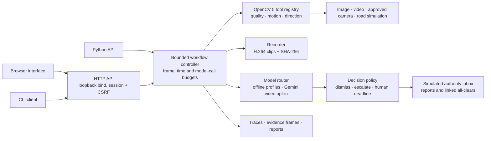
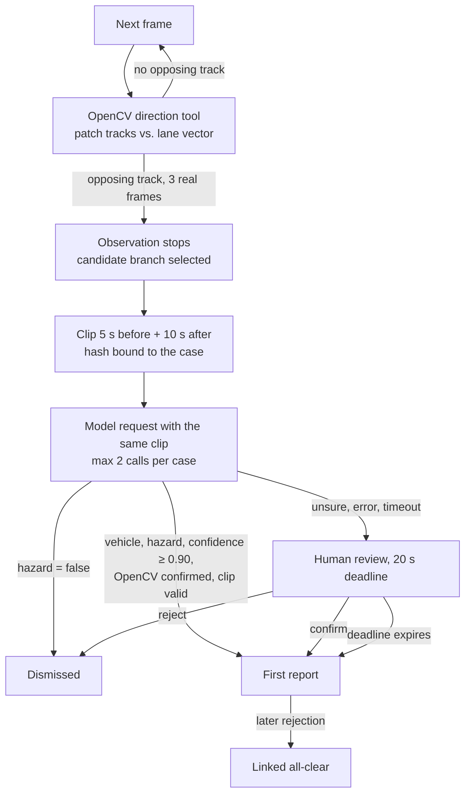
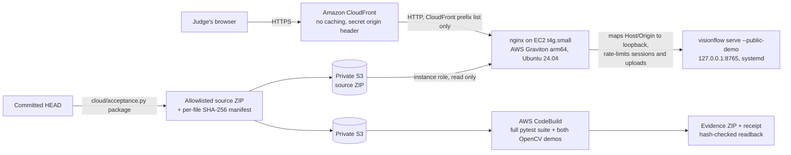

# VisionFlow architecture

## Components

## Agent workflow: perception, decision, action

The visual result decides every branch: no opposing track keeps the observation going; an
opposing track stops it, cuts the clip and triggers the model request; the model answer and the
human decision select the action. A model answer can never add a media source or an output
destination, and every transition is written to the trace.

## Deployment on AWS

* **Public demo** (`cloud/demo/demo-stack.yaml`): one Graviton instance runs the unchanged
  server. It still binds to loopback; nginx forwards only requests that carry CloudFront's
  secret header and rewrites Host/Origin to the loopback values the server expects. In
  `--public-demo` mode workflows can only read the road simulation and media uploaded to this
  server, uploads share a 200 MB quota, at most four live road sessions run at once, and systemd
  restarts the service with an empty data directory every 24 hours. No SSH; the instance is
  managed through SSM. Provider calls and cameras are disabled in this mode.
* **Cloud acceptance** (`cloud/template.json`, `cloud/buildspec.yml`): CodeBuild installs the
  pinned dependencies from an exact source ZIP, runs the full test suite and both OpenCV demos,
  and returns hashed evidence ([procedure](AWS_ACCEPTANCE.md)).

## Direction analysis

Bounded native-resolution grayscale patch matching: corners with eight-pixel spacing (at most
240 per lane), 21×21 patches searched within ±80 px, NCC ≥ 0.80 with a 0.05 gap to any distinct
second peak, reverse match within 1.5 px and local corner support at the end point. Tracks need
three distinct frames, at most 0.75 s and 80 px between observations. Matches run on a small
thread pool (OpenCV releases the GIL); each match is independent, so results do not depend on
the pool. The detector only sees pixels; scenario labels never enter it, and its candidates are
opposing motion, not vehicle classifications.

The road scene is synthetic and deterministic per seed. Static scenery is rendered once and
kept smooth so that it does not compete with moving vehicles for the per-lane corner budget.
